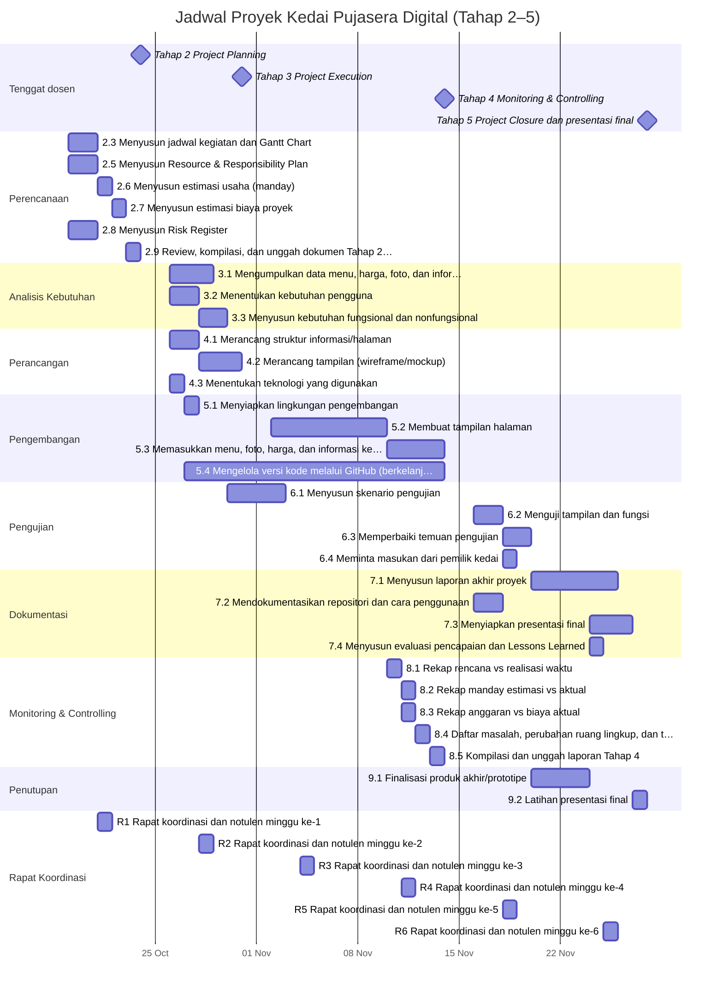

# Tahap 2 — Jadwal Proyek dan Gantt Chart

[⬅️ README](../../README.md) &nbsp;|&nbsp; [Resource & Responsibility Plan ➡️](resource-plan.md)

---

## Gantt Chart

## Ringkasan per Tahapan

| Tahapan | Mulai | Selesai | Durasi (hari kerja) |
| --- | :-: | :-: | :-: |
| Perencanaan (Tahap 2 — Project Planning) | 19/10/2026 | 23/10/2026 | 5 |
| Analisis Kebutuhan | 26/10/2026 | 29/10/2026 | 4 |
| Perancangan | 26/10/2026 | 30/10/2026 | 5 |
| Pengembangan | 27/10/2026 | 13/11/2026 | 14 |
| Pengujian | 30/10/2026 | 19/11/2026 | 15 |
| Dokumentasi | 16/11/2026 | 26/11/2026 | 9 |
| Monitoring & Controlling (Tahap 4) | 10/11/2026 | 13/11/2026 | 4 |
| Penutupan Proyek (Tahap 5 — Closure) | 20/11/2026 | 27/11/2026 | 6 |
| Rapat Koordinasi Mingguan (Setiap Rabu) | 21/10/2026 | 25/11/2026 | 26 |

## Daftar Aktivitas

| Kode | Aktivitas | PIC | Durasi | Dependensi | Mulai | Selesai |
| --- | --- | --- | :-: | --- | :-: | :-: |
| 2.3 | Menyusun jadwal kegiatan dan Gantt Chart | Hafiz | 2 hari | Mulai proyek | 19/10/2026 | 20/10/2026 |
| 2.5 | Menyusun Resource & Responsibility Plan | Andi | 2 hari | Mulai proyek | 19/10/2026 | 20/10/2026 |
| 2.6 | Menyusun estimasi usaha (manday) | Kharisa | 1 hari | FS: 2.3 | 21/10/2026 | 21/10/2026 |
| 2.7 | Menyusun estimasi biaya proyek | Hafiz | 1 hari | FS: 2.6 | 22/10/2026 | 22/10/2026 |
| 2.8 | Menyusun Risk Register | Arya | 2 hari | Mulai proyek | 19/10/2026 | 20/10/2026 |
| 2.9 | Review, kompilasi, dan unggah dokumen Tahap 2 ke GitHub | Andi, Hafiz | 1 hari | FS: 2.5, 2.7, 2.8 | 23/10/2026 | 23/10/2026 |
| 3.1 | Mengumpulkan data menu, harga, foto, dan informasi kedai | Kharisa | 3 hari | FS: 2.9 | 26/10/2026 | 28/10/2026 |
| 3.2 | Menentukan kebutuhan pengguna | Andi | 2 hari | FS: 2.9 | 26/10/2026 | 27/10/2026 |
| 3.3 | Menyusun kebutuhan fungsional dan nonfungsional | Andi | 2 hari | FS: 3.2 | 28/10/2026 | 29/10/2026 |
| 4.1 | Merancang struktur informasi/halaman | Arya | 2 hari | FS: 2.9 | 26/10/2026 | 27/10/2026 |
| 4.2 | Merancang tampilan (wireframe/mockup) | Arya | 3 hari | FS: 4.1, 3.2 | 28/10/2026 | 30/10/2026 |
| 4.3 | Menentukan teknologi yang digunakan | Hafiz | 1 hari | FS: 2.9 | 26/10/2026 | 26/10/2026 |
| 5.1 | Menyiapkan lingkungan pengembangan | Hafiz | 1 hari | FS: 4.3 | 27/10/2026 | 27/10/2026 |
| 5.2 | Membuat tampilan halaman | Arya | 6 hari | FS: 4.2, 5.1 | 02/11/2026 | 09/11/2026 |
| 5.3 | Memasukkan menu, foto, harga, dan informasi kedai | Kharisa | 4 hari | FS: 5.2, 3.1 | 10/11/2026 | 13/11/2026 |
| 5.4 | Mengelola versi kode melalui GitHub (berkelanjutan) | Hafiz | 14 hari | SS: 5.1 | 27/10/2026 | 13/11/2026 |
| 6.1 | Menyusun skenario pengujian | Andi | 2 hari | FS: 3.3 | 30/10/2026 | 02/11/2026 |
| 6.2 | Menguji tampilan dan fungsi | Arya, Andi | 2 hari | FS: 5.3, 6.1 | 16/11/2026 | 17/11/2026 |
| 6.3 | Memperbaiki temuan pengujian | Kharisa, Hafiz | 2 hari | FS: 6.2 | 18/11/2026 | 19/11/2026 |
| 6.4 | Meminta masukan dari pemilik kedai | Andi | 1 hari | FS: 6.2 | 18/11/2026 | 18/11/2026 |
| 7.1 | Menyusun laporan akhir proyek | Andi | 4 hari | FS: 6.3, 6.4 | 20/11/2026 | 25/11/2026 |
| 7.2 | Mendokumentasikan repositori dan cara penggunaan | Hafiz | 2 hari | FS: 5.4 | 16/11/2026 | 17/11/2026 |
| 7.3 | Menyiapkan presentasi final | Kharisa | 3 hari | FS: 9.1 | 24/11/2026 | 26/11/2026 |
| 7.4 | Menyusun evaluasi pencapaian dan Lessons Learned | Arya, Kharisa | 1 hari | FS: 9.1 | 24/11/2026 | 24/11/2026 |
| 8.1 | Rekap rencana vs realisasi waktu | Hafiz | 1 hari | Tanggal tetap | 10/11/2026 | 10/11/2026 |
| 8.2 | Rekap manday estimasi vs aktual | Kharisa | 1 hari | Tanggal tetap | 11/11/2026 | 11/11/2026 |
| 8.3 | Rekap anggaran vs biaya aktual | Andi | 1 hari | Tanggal tetap | 11/11/2026 | 11/11/2026 |
| 8.4 | Daftar masalah, perubahan ruang lingkup, dan tindakan korektif | Arya | 1 hari | Tanggal tetap | 12/11/2026 | 12/11/2026 |
| 8.5 | Kompilasi dan unggah laporan Tahap 4 | Andi | 1 hari | FS: 8.1, 8.2, 8.3, 8.4 | 13/11/2026 | 13/11/2026 |
| 9.1 | Finalisasi produk akhir/prototipe | Hafiz, Arya | 2 hari | FS: 6.3 | 20/11/2026 | 23/11/2026 |
| 9.2 | Latihan presentasi final | Andi, Hafiz, Arya, Kharisa | 1 hari | FS: 7.1, 7.3 | 27/11/2026 | 27/11/2026 |
| R1 | Rapat koordinasi dan notulen minggu ke-1 | Andi, Hafiz, Arya, Kharisa | 1 hari | Tanggal tetap | 21/10/2026 | 21/10/2026 |
| R2 | Rapat koordinasi dan notulen minggu ke-2 | Andi, Hafiz, Arya, Kharisa | 1 hari | Tanggal tetap | 28/10/2026 | 28/10/2026 |
| R3 | Rapat koordinasi dan notulen minggu ke-3 | Andi, Hafiz, Arya, Kharisa | 1 hari | Tanggal tetap | 04/11/2026 | 04/11/2026 |
| R4 | Rapat koordinasi dan notulen minggu ke-4 | Andi, Hafiz, Arya, Kharisa | 1 hari | Tanggal tetap | 11/11/2026 | 11/11/2026 |
| R5 | Rapat koordinasi dan notulen minggu ke-5 | Andi, Hafiz, Arya, Kharisa | 1 hari | Tanggal tetap | 18/11/2026 | 18/11/2026 |
| R6 | Rapat koordinasi dan notulen minggu ke-6 | Andi, Hafiz, Arya, Kharisa | 1 hari | Tanggal tetap | 25/11/2026 | 25/11/2026 |

## Milestone

| Kode | Milestone | Tanggal |
| --- | --- | :-: |
| M2 | Tahap 2 Project Planning dikumpulkan | 24/10/2026 |
| M3 | Tahap 3 Project Execution dikumpulkan | 31/10/2026 |
| M4 | Tahap 4 Monitoring & Controlling dikumpulkan | 14/11/2026 |
| M5 | Tahap 5 Project Closure dan presentasi final | 28/11/2026 |

## Kesesuaian dengan Tenggat

| Tahap | Tenggat dosen | Pekerjaan selesai (jadwal) | Cadangan |
| --- | :-: | :-: | :-: |
| Tahap 2 — Project Planning | 24/10/2026 | 23/10/2026 | 1 hari |
| Tahap 3 — Project Execution | 31/10/2026 | 30/10/2026 | 1 hari |
| Tahap 4 — Monitoring & Controlling | 14/11/2026 | 13/11/2026 | 1 hari |
| Tahap 5 — Project Closure | 28/11/2026 | 27/11/2026 | 1 hari |

> Tahap 3 diukur dari selesainya analisis kebutuhan, perancangan, dan lingkungan pengembangan; Tahap 4 dari kompilasi laporan monitoring; Tahap 5 dari dokumentasi dan penutupan.

<b>Asumsi jadwal</b>

- Hari libur nasional tidak diperhitungkan.
- Rapat koordinasi dijadwalkan tiap Rabu.
- Kode WBS 2.5–2.9, 8, dan 9 ditambahkan sesuai output Tahap 2, 4, dan 5.

